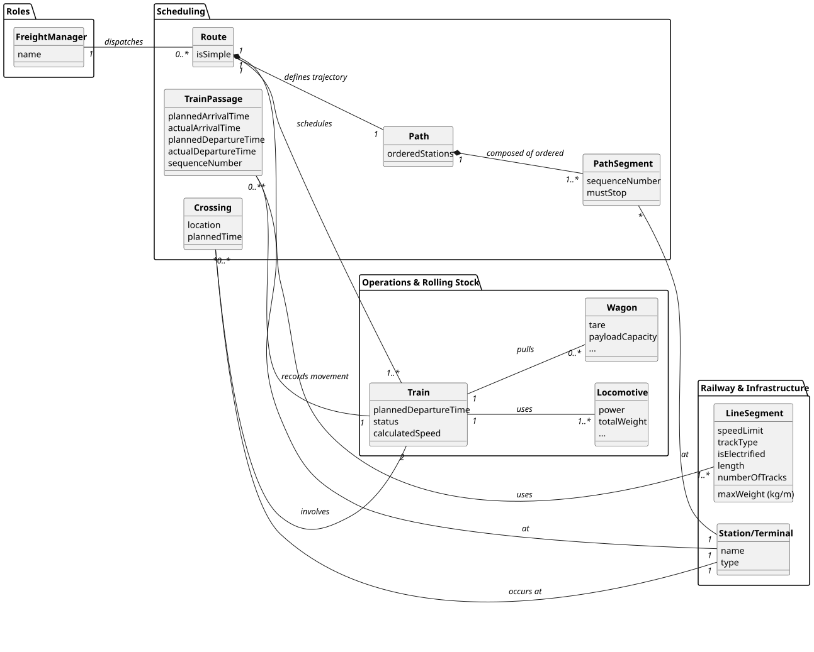

# USLP07 - Train Dispatch - Scheduling and Route Calculation

## 2. Analysis

### 2.1. Relevant Domain Model Excerpt

The following entities from the domain model are relevant for this use case:

**Infrastructure Management Package:**
- **Endpoint**: Generic facility (Station, Terminal, Freight Yard) where trains stop or pass.
    - Has unique ID and geographic coordinates (latitude/longitude).
    - Can be a point of origin/destination for a Freight.
- **Line Segment**: A section of track connecting two endpoints.
    - Has characteristics like gauge (width), maximum weight ($kg/m$), speed limit, track type (single/double track), and electrification status.
    - Belongs to one Rail Line.
- **Rail Line**: A route connecting two endpoints, composed of multiple Line Segments.

**Rolling Stock Package:**
- **Locomotive**: Engine used to pull trains.
    - Has attributes like power, weight, type (diesel/electric), and gauge.
    - Used to form a Train.
- **Wagon/Freight Car**: Vehicle designed for specific goods.
    - Has characteristics like payload, volume capacity, dimensions, and tare.
    - Used to form a Freight.
- **Train**: A composition of one or more Locomotives and Wagons, owned by a Train Operator.

**Traffic & Dispatching Package:**
- **Freight**: The cargo (set of Wagons) transported from endpoint A to endpoint B.
- **Route**: The planned path for a Train, defined as an ordered list of Endpoints (stations).
    - Can be **Simple** (single Freight) or **Complex** (multiple Freights).
    - Has a planned Start Date/Time.

**Key Relationships:**
- **Train $\rightarrow$ Route**: A train has a scheduled route.
- **Route $\rightarrow$ Endpoint**: A Route is a sequence of Endpoints.
- **Route $\rightarrow$ Line Segment**: The route uses Rail Line Segments.
- **Train $\rightarrow$ Locomotive, Wagon**: A train is composed of rolling stock.

---

### 2.2. Other Remarks

The core of this Use Story involves complex calculations and conflict resolution:

1.  **Speed Calculation**: For each Line Segment on the Route, the system must calculate the maximum possible speed, $V_{max}$, which is the minimum of two constraints:
    $$V_{max} = \min(V_{track}, V_{traction})$$
    * $V_{track}$: Maximum speed limit defined by the Line Segment's characteristics.
    * $V_{traction}$: Maximum speed achievable based on the combined power of the Locomotives and the total weight of the Train (locomotives + loaded wagons). (This calculation relates to FSIAP, Applied Physics ).

2.  **Time Estimation**: Once $V_{max}$ is determined for each segment, the estimated time of passage ($T$) for the segment is calculated using distance ($D$) and speed ($V_{max}$), assuming instantaneous acceleration:
    $$T = D / V_{max}$$

3.  **Conflict Resolution (Crossing Operations)**: For trains running on single-track segments, the system must detect potential head-on conflicts. When a conflict is detected, the scheduler must plan a **crossing operation** at the preceding station or siding. This operation consumes time and must be included in the passage times.

4.  **Route Input**: The input path is defined **manually** by the Freight Manager, which is intended to guide the Freight Manager in situations where the automatic system is not available.