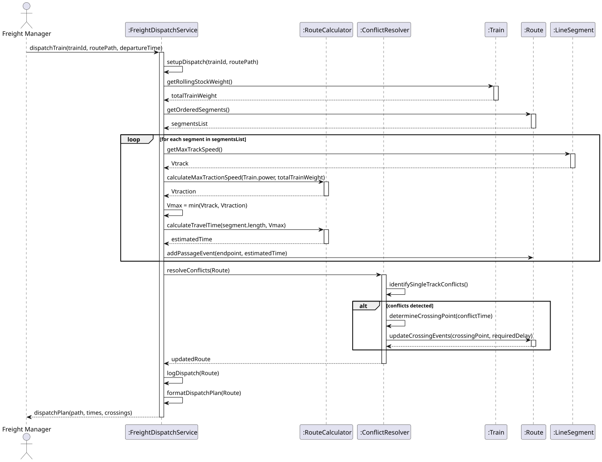
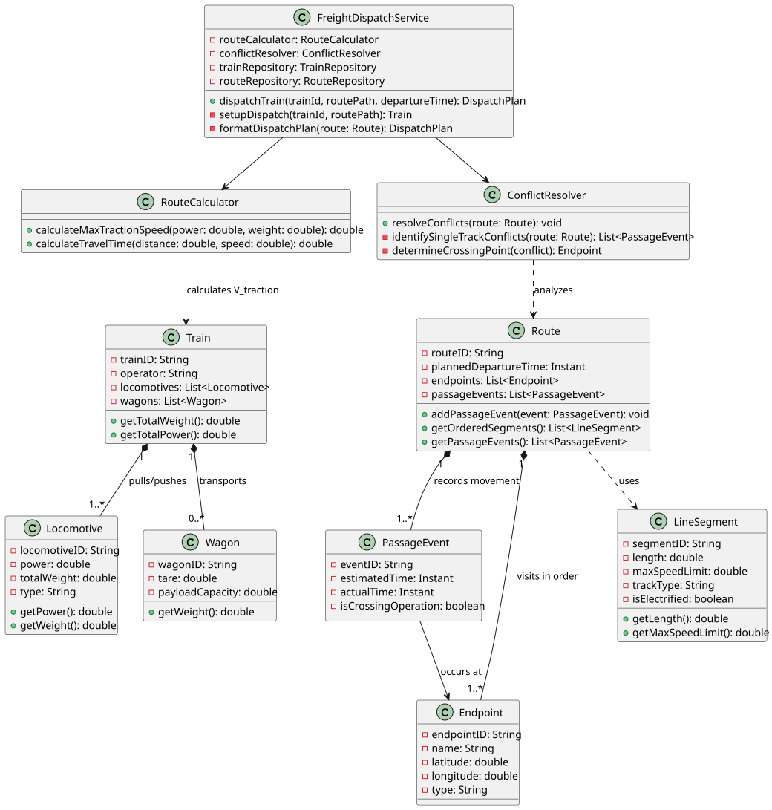

# USLP07 - Train Dispatch - Scheduling and Route Calculation

## 3. Design

### 3.1. Rationale

**The rationale grounds on the SSD interactions and the identified input/output data (Section 1.6 and 2.2).**

| Interaction ID | Question: Which class is responsible for... | Answer | Justification (with patterns) |
|:------------- |:--------------------- |:------------|:---------------------------- |
| Step 1 | ...coordinating the dispatch setup? | FreightDispatchService | Controller Pattern: coordinates input data validation and initialization. |
| Step 2 | ...calculating the maximum speed $V_{max}$ on a segment? | Train | Information Expert: knows its total weight and traction power, and receives segment limits. |
| Step 3 | ...determining time $T$ needed for a segment? | RouteCalculator | Pure Fabrication: dedicated service for physics-based travel time calculation ($T=D/V_{max}$). |
| Step 4 | ...checking for potential traffic conflicts? | ConflictResolver | Pure Fabrication: dedicated service to analyze train passage times on Line Segments. |
| Step 5 | ...storing the maximum speed and duration for a segment? | LineSegment | Information Expert: stores its static limits, but $V_{max}$ is transient/calculated. |
| Step 6 | ...managing the ordered list of passage times? | Route | Information Expert: holds the sequence of Endpoints and PassageEvents. |
| Step 7 | ...recording a time of passage/stop? | PassageEvent | Information Expert: represents the recorded instant and status at an Endpoint. |
| Step 8 | ...displaying the final dispatch plan? | FreightDispatchService | Controller Pattern: presents the Route data (times, crossings) to the Freight Manager. |

### Systematization

According to the taken rationale, the conceptual classes promoted to software classes are:

* Train
* Locomotive
* Wagon
* Route
* Endpoint
* LineSegment
* PassageEvent

Other software classes (i.e. Pure Fabrication) identified:

* FreightDispatchService (Controller)
* RouteCalculator (Calculation logic)
* ConflictResolver (Traffic management)

---

## 3.2. Sequence Diagram (SD)

---

## 3.3. Class Diagram (CD)

---

## 3.4. Design Patterns Applied

* **Information Expert**: **Train** knows its total power/weight for $V_{traction}$ calculation. **Route** manages its ordered list of passage events.
* **Pure Fabrication**: **RouteCalculator** is responsible solely for the travel time calculation ($T=D/V$) and **ConflictResolver** for detecting/resolving single-track conflicts. **FreightDispatchService** acts as the system controller.
* **Controller**: **FreightDispatchService** handles all system interactions from the Freight Manager.
* **Factory**: A factory might be used to assemble the **Train** object (Locomotives + Wagons) when a new dispatch request is created.