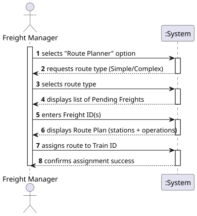

# USLP08 - Freight Route Planner - Define and Assign Routes for Pending Freights

## 1. Requirements Engineering

### 1.1. User Story Description

As a **Freight Manager**, I want to use a route planner that allows me to define/assign routes in order to accomplish a list of pending freights. A route can be simple or complex.

### 1.2. Customer Specifications and Clarifications

The route planner must be able to:

* Access the database to retrieve a **list of pending freights** (freights not yet assigned to any train).
* Allow the Freight Manager to select one or more freights to plan a route.
* Support two types of route planning:
  * **Simple Route**: A route for a single freight, consisting of two stops (origin and destination).
  * **Complex Route**: A route for multiple freights, optimizing stops by grouping common facilities to reduce the total number of stops.
* Display a clear **sequence of stations** (stops) along the route.
* For each stop, indicate:
  * **Freights to Load**: Which freights should be loaded at this station.
  * **Freights to Unload**: Which freights should be unloaded at this station.
* Provide the option to **assign** the planned route to a specific train, marking the freights as no longer pending.
* All database operations must be performed using **PL/SQL functions** to ensure data integrity and consistency.

### 1.3. Acceptance Criteria

* **AC1:** A list with the sequence of stations and the cargos to be loaded/unloaded should be presented.
* **AC2:** The database should be accessed through PL/SQL functions.
* **AC3:** The system must validate that all selected freights are still pending before planning a route.
* **AC4:** The system must distinguish between simple routes (single freight) and complex routes (multiple freights).
* **AC5:** For complex routes, the system should optimize stops by grouping freights with common origin/destination facilities.
* **AC6:** When assigning a route to a train, all freights in that route must be marked as assigned in a single transaction to maintain data consistency.

### 1.4. Found out Dependencies

* **BDDAD (Database Management)**: Requires a populated relational model with `Freight`, `Facility`, and `Train` data.
* **PL/SQL Functions**: Requires the following database functions:
  * `get_pending_freights()`: Returns all freights not yet assigned to trains.
  * `get_freight_by_id(freight_id)`: Returns detailed information about a specific freight.
  * `is_freight_pending(freight_id)`: Checks if a freight is still pending.
  * `assign_multiple_freights_to_train(train_id, freight_ids)`: Assigns multiple freights to a train in a single transaction.
* **Domain Concepts**: `Freight`, `Facility`, `FreightRoute`, `RouteStop`, `FreightRoutePlannerService`.
* **Related User Stories**: This functionality complements USLP07 (Train Dispatch) by providing the freight assignments that trains will transport.

### 1.5 Input and Output Data

| Data Type | Examples/Fields | Source/Usage |
| :--- | :--- | :--- |
| **Input** | **Freight ID(s)** | Entered by Freight Manager |
| | **Train ID** | Entered by Freight Manager (for assignment) |
| | Connection Credentials | System Configuration |
| **Output** | **Pending Freights List** | Retrieved via `get_pending_freights()` |
| | **Route Plan** | Calculated by FreightRoutePlannerService |
| | **Stop Sequence** | List of RouteStop objects |
| | **Load/Unload Operations** | Freight operations at each stop |
| | **Assignment Confirmation** | Number of freights assigned |

### 1.6. System Sequence Diagram (SSD)

### 1.7 Other Relevant Remarks

* This module is a core component of the "Freight and Traffic System" (the `warehouseMngt` module implemented in JAVA).
* The route planning logic distinguishes between:
  * **Simple Routes**: Direct origin → destination (2 stops).
  * **Complex Routes**: Multiple freights with optimized stop sequences to minimize total stops.
* The optimization strategy for complex routes prioritizes loading operations before unloading operations to ensure freights are available for transport.
* All database interactions are performed through **PL/SQL functions** to encapsulate business logic and maintain data integrity.
* The assignment operation uses a **transactional approach** to ensure all freights are assigned atomically (all or nothing).
