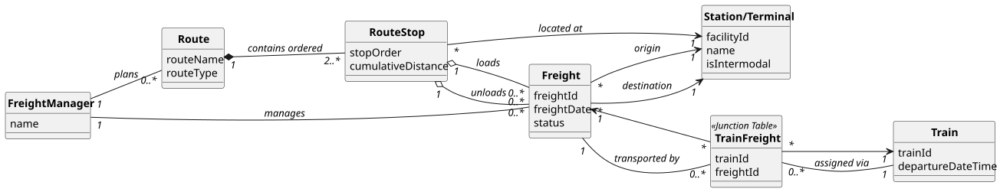

# USLP08 - Freight Route Planner - Define and Assign Routes for Pending Freights

## 2. Analysis

### 2.1. Relevant Domain Model Excerpt

The following entities from the domain model are relevant for this use case:

**Infrastructure Management Package:**
- **Station/Terminal (Facility)**: A location where trains stop to load/unload freight.
    - Has unique ID, name, and geographic coordinates.
    - Can be either a regular station or an intermodal terminal.
    - Serves as origin or destination for Freights.

**Operations Package:**
- **Freight**: The cargo that needs to be transported from one facility to another.
    - Has a unique Freight ID.
    - Has an origin Facility and destination Facility.
    - Has a departure date.
    - Status can be **Pending** (not assigned to any train) or **Assigned** (linked to a train via TrainFreight junction table).
- **Train**: The vehicle composition that will transport freights.
    - Has a Train ID, departure time, and path.
    - Can be assigned multiple freights.

**Route Planning Package:**
- **Route**: The planned sequence of stops for transporting one or more freights.
    - Can be **Simple** (single freight, 2 stops: origin → destination).
    - Can be **Complex** (multiple freights, optimized stops grouping common facilities).
    - Contains an ordered list of RouteStops.
- **RouteStop**: A specific stop along the route.
    - Has a stop order/sequence number.
    - References a Facility (station/terminal).
    - Lists **Freights to Load** at this stop.
    - Lists **Freights to Unload** at this stop.

**Database Package:**
- **TrainFreight**: Junction table that links Train and Freight.
    - When a freight is assigned to a train, a record is inserted here.
    - This changes the freight's status from **Pending** to **Assigned**.

**Key Relationships:**
- **Freight → Facility**: Each freight has an origin and destination facility (many-to-one relationships).
- **Route → RouteStop**: A route contains multiple stops in sequence (one-to-many composition).
- **RouteStop → Facility**: Each stop is located at a facility (many-to-one).
- **RouteStop → Freight**: A stop can load/unload multiple freights (many-to-many).
- **Train → Freight**: A train transports multiple freights via TrainFreight junction table (many-to-many).

---

### 2.2. Other Remarks

The core functionality of this Use Case involves route planning and freight assignment:

1. **Pending Freight Identification**: The system identifies freights as "pending" by querying the database for freights NOT present in the `TrainFreight` junction table:
   $$\text{Pending Freights} = \text{Freight} \setminus \{\text{freight\_id} \in \text{TrainFreight}\}$$

2. **Simple Route Planning**: For a single freight, the route consists of exactly 2 stops:
   - **Stop 1**: Origin facility (LOAD the freight).
   - **Stop 2**: Destination facility (UNLOAD the freight).

3. **Complex Route Planning**: For multiple freights, the system optimizes by:
   - Grouping freights with common origin/destination facilities.
   - Creating a single stop for all freights sharing the same facility.
   - Ordering stops to prioritize loading operations before unloading operations.
   - Minimizing total number of stops: $\text{Stops} = |\text{Unique Facilities}|$

4. **Route Assignment**: When a route is assigned to a train:
   - All freight IDs from the route are extracted.
   - A PL/SQL procedure inserts records into `TrainFreight` table in a single transaction.
   - Freights are atomically removed from pending status.
   - Transaction rollback occurs if any assignment fails (data integrity).

5. **Database Access Pattern**: All database operations use PL/SQL functions/procedures (AC2):
   - `get_pending_freights()` - Returns cursor with pending freights.
   - `get_freight_by_id(freight_id)` - Returns specific freight details.
   - `is_freight_pending(freight_id)` - Returns 1 if pending, 0 if assigned.
   - `assign_multiple_freights_to_train(train_id, freight_ids)` - Assigns freights in transaction.

6. **Validation Logic**: Before route assignment, the system validates:
   - All selected freights still exist in database.
   - All selected freights are still pending (concurrent access check).
   - Target train exists in database.
   - No duplicate assignments occur.
