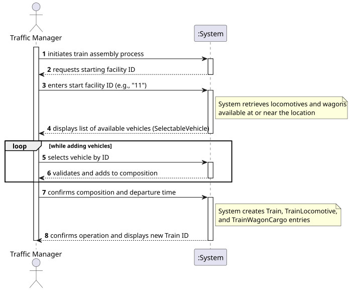

# USLP09 - Train Assembly - Rolling Stock Selection

## 1. Requirements Engineering

### 1.1. User Story Description

As a **Traffic Manager**, I want to identify and select available rolling stock (locomotives and wagons) at a specific facility, so that I can **assemble a train composition** for a new service or route.

### 1.2. Customer Specifications and Clarifications

The system must be able to:

* Allow the user to input a **Starting Facility ID** (the location where the train will be formed).
* Access the database to identify all **Locomotives** and **Wagons** currently located at that facility.
* Filter the vehicles to show only those that are **available** (i.e., not currently assigned to another active train or under maintenance).
* Display the results in a clear list, showing relevant technical details (ID, type, current status).
* Allow the manager to visualize vehicles that might be "In Transit" to that location (if supported by the domain logic), or strictly those "Parked".

### 1.3. Acceptance Criteria

* **AC1:** The system must validate the input Facility ID (must exist in the database).
* **AC2:** If no vehicles are available at the chosen location, the system must provide a clear "No vehicles found" message.
* **AC3:** The output list must distinguish between **Locomotives** (showing Power/Traction info) and **Wagons** (showing Weight/Capacity info).
* **AC4:** The operation must be performed using a **Database Connection** (JDBC) to ensure real-time data accuracy.
* **AC5:** The system must handle database errors gracefully (e.g., connection failure) without crashing the application.

### 1.4. Found out Dependencies

* **BDDAD (Database Management)**: Requires a populated relational model with `Facility`, `Locomotive`, `Wagon`, and `VehicleLocation` data.
* **Domain Concepts**: `SelectableVehicle` class (to represent the data row), `TrafficManagerService` (to handle the logic).
* **USLP10 (Dependency)**: This US (Assembly) is a prerequisite for USLP10 (Scheduling). You cannot schedule a train movement if the train composition hasn't been created first.

### 1.5 Input and Output Data

| Data Type | Examples/Fields | Source/Usage |
| :--- | :--- | :--- |
| **Input** | **Starting Facility ID** | Entered by Traffic Manager (Console) |
| | Connection Credentials | System Configuration (`TrafficManagerService`) |
| **Output** | **List of Vehicles** | System Queries the DB and displays list |
| | Vehicle Status | "Parked" or "In Transit" |
| | Vehicle Details | ID, Name/Model, Distance (if applicable) |

### 1.6. System Sequence Diagram (SSD)

### 1.7 Other Relevant Remarks

This module corresponds to the assembleTrainUI method in the TrafficManagerMenuController.

The differentiation between "Parked" and "In Transit" (seen in the SelectableVehicle.toString() method) adds value to the manager, allowing for better planning of resources that are about to arrive.

Unlike USLP10, this user story does not involve physics calculations (speed/mass); it is purely a Resource Management and Inventory operation.