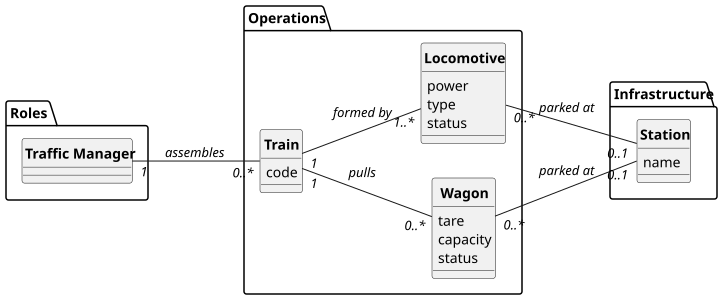

# USLP09 - Train Assembly - Rolling Stock Selection

## 2. Analysis

### 2.1. Relevant Domain Model Excerpt

The following entities from the domain model are relevant for this use case:

**Infrastructure Package:**
- **Station/Terminal (Facility)**: The physical location where the train assembly takes place.
    - Has unique ID and name.
    - Serves as the filter criteria for locating vehicles.
    - Vehicles can be "parked" here or "in transit" towards here.

**Rolling Stock Package:**
- **Train**: The new composition being assembled.
    - Has a Train ID and a planned departure time.
    - Will be linked to specific locomotives and wagons selected by the user.
- **Locomotive**: The traction unit.
    - Has technical attributes (Power, Type) relevant for the user selection.
    - Has a dynamic status (Free/Parked or Assigned/InTransit).
- **Wagon**: The cargo carrying unit.
    - Has technical attributes (Tare, Capacity).
    - Has a dynamic status.

**Operations Package:**
- **VehicleLocation**: Tracks the current position of each vehicle.
    - Associates a vehicle (Locomotive/Wagon) with a Facility.
    - Timestamped to ensure the most recent location is used.

**Key Relationships:**
- **Locomotive → Station**: A locomotive is parked at a specific station (zero-to-one).
- **Wagon → Station**: A wagon is parked at a specific station (zero-to-one).
- **Train → Locomotive**: A train is formed by one or more locomotives (composition).
- **Train → Wagon**: A train pulls zero or more wagons (composition).

---

### 2.2. Other Remarks

The core functionality of this Use Case involves resource querying and filtering:

1. **Available Vehicle Identification**: The system identifies vehicles as "Available for Assembly" by querying the database for vehicles located at the input Facility ID that are NOT currently assigned to an active train:
   $$\text{Available Vehicles} = \{v \in \text{Vehicles} \mid \text{location}(v) = \text{Facility}_{ID} \land \text{status}(v) \neq \text{'Assigned'}\}$$

2. **Differentiation of Status**: As per requirements, the list must distinguish:
    - **Parked**: Vehicles physically present at the station.
    - **In Transit**: Vehicles assigned to a train that is destined for this station (arriving soon). The logic checks if `Vehicle.current_train.destination == Facility_ID`.

3. **Data Retrieval Strategy**:
    - The system uses a **DTO (Data Transfer Object)** pattern named `SelectableVehicle` to flatten the different hierarchies of Locomotives and Wagons into a single list for the UI.
    - Ordering: Vehicles are presented in descending order of distance from the starting point (if "In Transit") or grouped by type if "Parked".

4. **Database Access Pattern**: All database operations use PL/SQL functions to return cursors (AC2):
    - `func_get_available_vehicles(facility_id)` - Returns a cursor containing both Locomotives and Wagons, with a column indicating their type and status.
    - `func_check_vehicle_availability(vehicle_id)` - Returns boolean validation before adding to a train.

5. **Validation Logic**:
    - **Facility Existence**: The input Facility ID must exist in the database.
    - **Composition Rules**: While not strictly enforced by the UI list, the subsequent assembly logic (USLP10) will require at least one locomotive for a train to be dispatchable.