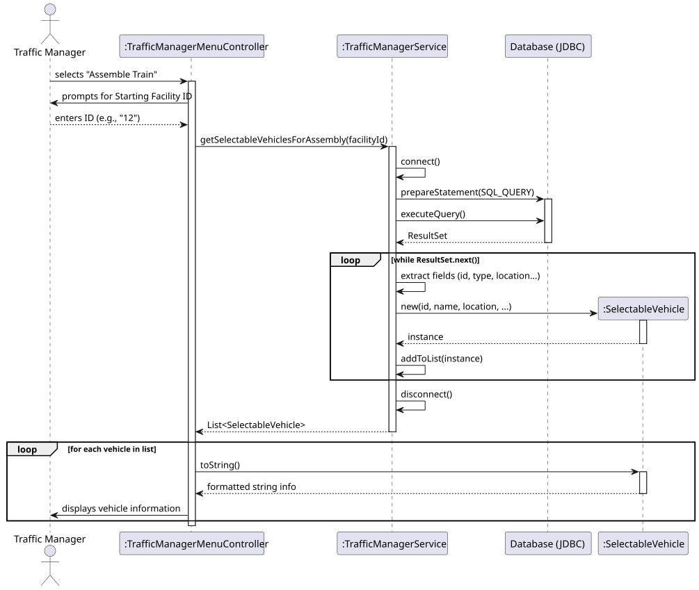
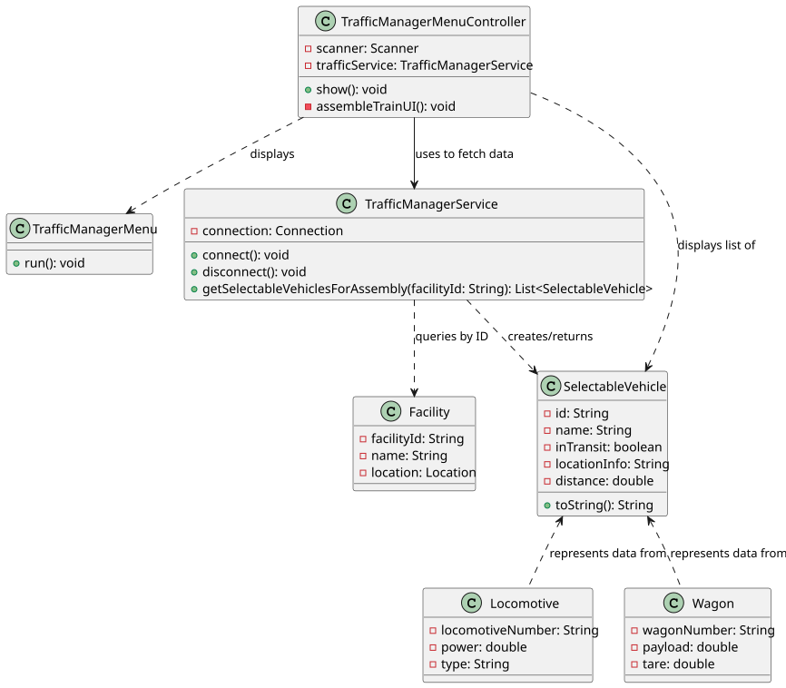

# USLP09 - Train Assembly - Rolling Stock Selection

## 3. Design

### 3.1. Rationale

**The rationale grounds on the SSD interactions and the identified input/output data (Section 1.6).**

| Interaction ID | Question: Which class is responsible for... | Answer | Justification (with patterns) |
|:------------- |:--------------------- |:------------|:---------------------------- |
| Step 1 | ...handling the user interaction and menu navigation? | TrafficManagerMenuController | **Controller Pattern**: It acts as the entry point for the UI, orchestrating the flow between the user and the system logic. |
| Step 2 | ...managing the database connection and query execution? | TrafficManagerService | **Pure Fabrication**: A dedicated service class to handle technical complexity (JDBC/SQL) separate from the domain logic. |
| Step 3 | ...retrieving the list of vehicles for a specific facility? | TrafficManagerService | **Information Expert**: The service has the knowledge (SQL queries) and means (Connection) to fetch data from the persistence layer. |
| Step 4 | ...representing the specific vehicle data needed for the UI? | SelectableVehicle | **DTO (Data Transfer Object)**: Aggregates data from multiple tables (Locomotive, Wagon, Location) into a single object optimized for display. |
| Step 5 | ...formatting the vehicle status (e.g., "In Transit" vs "Parked")? | SelectableVehicle | **Information Expert**: The object holds its own state and knows how to format its string representation (`toString()`). |
| Step 6 | ...displaying the final list to the Traffic Manager? | TrafficManagerMenuController | **Controller Pattern**: Receives the processed list from the service and presents it to the user. |

### Systematization

According to the taken rationale, the conceptual classes promoted to software classes are:

* **SelectableVehicle** (Represents a view of Locomotive/Wagon)
* **Facility** (Implied as the search criterion)

Other software classes (i.e. Pure Fabrication) identified:

* **TrafficManagerMenuController** (UI Controller)
* **TrafficManagerService** (Business Logic & Data Access)

---

## 3.2. Sequence Diagram (SD)

---

## 3.3. Class Diagram (CD)

---

## 3.4. Design Patterns Applied

* **Controller**: **TrafficManagerMenuController** is responsible for receiving the user's input (Facility ID) and deciding which service method to call.
* **Pure Fabrication**: **TrafficManagerService** was created to handle the Database/JDBC operations. It does not represent a concept in the problem domain (Rolling Stock), but is necessary for High Cohesion and Low Coupling in the software design.
* **Information Expert**: **SelectableVehicle** contains all the necessary attributes (ID, name, location type) to describe itself to the user.
* **Data Transfer Object (DTO)**: The **SelectableVehicle** class acts as a DTO. It does not map 1:1 to a database table but rather represents a specific "view" of data required for the Train Assembly process (combining info from Locomotives, Wagons, and current positions).