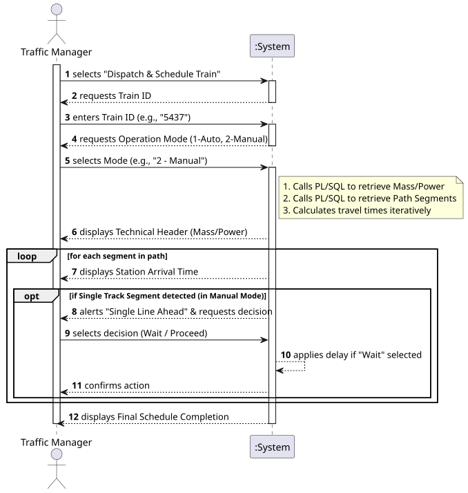

# USLP10 - Train Dispatch - Scheduling and Route Calculation

## 1. Requirements Engineering

### 1.1. User Story Description

As a **Traffic Manager**, I want to **schedule the movement of a train** along a specific route, calculating the estimated arrival times at each station based on the train's physical characteristics (mass/power) and the line's constraints (speed limits/track type).

### 1.2. Customer Specifications and Clarifications

The system must be able to:

* Allow the manager to select a **Train ID** (previously assembled in USLP09).
* Offer two modes of operation:
    1.  **Automatic:** The system calculates the schedule based on stored paths.
    2.  **Manual (Interactive):** The Freight Manager guides the train dispatch, validating entry into specific segments.
* Calculate the **Maximum Viable Speed** for each segment, considering:
    * The **Track Limit** (e.g., 90 km/h).
    * The **Train's Maximum Speed** (fixed at 100 km/h for this MVP).
    * *(Future)* Traction curves based on Mass/Power.
* Identify **Single Track** segments versus **Double/Complex** lines.
* In **Manual Mode**, if a Single Track is encountered, the system must pause and ask the Manager to decide:
    * **Wait** for a crossing (adding a delay).
    * **Proceed** immediately.
* **Technical Constraint:** All database access for this specific module must be performed through **PL/SQL Functions** to ensure performance and data encapsulation.

### 1.3. Acceptance Criteria

* **AC1:** The physics calculation must correctly display the Total Mass and Total Power of the train at the start of the schedule.
* **AC2:** The system must detect **Single Track** segments and trigger a "Crossing Alert" in Manual Mode.
* **AC3:** The database must be accessed strictly via `CallableStatement` invoking stored **PL/SQL Functions** (`func_get_train_tech_data`, `func_get_train_path`), avoiding direct SQL `SELECT` queries in the Java code.
* **AC4:** The output must display the estimated Arrival Time for every station in the path, formatted clearly (e.g., `yyyy-MM-dd HH:mm:ss`).

### 1.4. Found out Dependencies

* **USLP09 (Train Assembly)**: A train must be created/assembled before it can be dispatched.
* **BDDAD (PL/SQL)**: Relies on the existence of `func_get_train_tech_data` and `func_get_train_path` in the Oracle Database.
* **Domain Concepts**: `TrainMovementService` (Logic), `TrainMovementController` (UI).

### 1.5 Input and Output Data

| Data Type | Examples/Fields | Source/Usage |
| :--- | :--- | :--- |
| **Input** | **Train ID** | Entered by Traffic Manager |
| | **Dispatch Mode** | Automatic (1) or Manual (2) |
| | **User Decisions** | "Wait" or "Proceed" (in Manual Mode) |
| **Output** | **Technical Header** | Mass (tons), Power (kW) |
| | **Schedule Table** | Station Name, Arrival Time, Line Alerts |
| | **Alerts** | "Single line ahead", "Crossing required" |

### 1.6. System Sequence Diagram (SSD)

