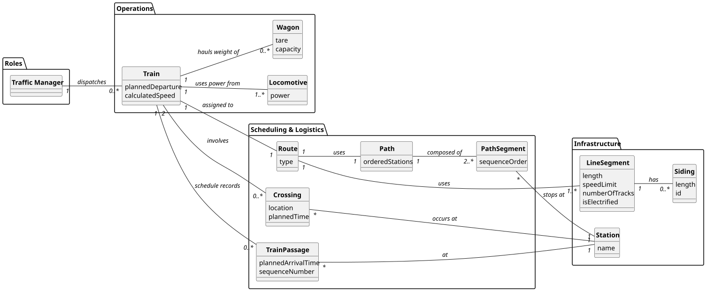

# USLP10 - Train Dispatch - Scheduling and Route Calculation

## 2. Analysis

### 2.1. Relevant Domain Model Excerpt

The following entities from the domain model are relevant for this use case:

**Infrastructure Package:**
- **LineSegment**: A section of track connecting two points.
    - **Length**: Used for time calculation ($D$).
    - **Speed Limit**: Used for constraining velocity ($V_{track}$).
    - **Number of Tracks**: Determines if the segment is Single or Double line.
- **Siding**: A designated area for crossing trains on single lines.
- **Station**: The nodes in the path where arrival times are recorded.

**Rolling Stock Package:**
- **Train**: The entity being scheduled.
    - Has **Total Mass** (sum of Wagon Tare + Cargo + Locomotive Weight).
    - Has **Total Power** (sum of Locomotives).
    - Has **Max Speed** (limit of the vehicle itself).

**Scheduling Package:**
- **Path**: The ordered sequence of LineSegments and Stations the train traverses.
- **TrainPassage**: The recorded schedule event.
    - Stores `PlannedArrivalTime` and `PlannedDepartureTime`.
- **Crossing**: Represents a conflict resolution event where a train waits for another.

**Key Relationships:**
- **Train → Path**: The train follows a specific ordered path.
- **Path → LineSegment**: The path is composed of a sequence of segments.
- **LineSegment → Siding**: Segments may contain sidings for crossing operations.
- **TrainPassage → Station**: Each time calculation results in a timestamp at a station.

---

### 2.2. Other Remarks

The core functionality involves physics-based time calculation and interactive decision-making:

1. **Physics Calculation (Speed)**:
   The effective speed ($V_{eff}$) on any given segment is the minimum of the track limit and the train's capability:
   $$V_{eff} = \min(V_{track\_limit}, V_{train\_max}, V_{traction\_limit})$$
   *(Note: For MVP, $V_{traction\_limit}$ is simplified or assumed sufficient, focusing on track limits).*

2. **Time Calculation**:
   The travel time ($T$) for a segment of length $D$ is calculated as:
   $$T_{segment} = \frac{D}{V_{eff}} + T_{dwell}$$
   Where $T_{dwell}$ is the standard stop time at a station (e.g., 2 minutes).

3. **Single Line Logic & Manual Dispatch**:
   The system detects potential bottlenecks based on infrastructure data:
    - **Detection**: If `LineSegment.number_of_tracks == 1`.
    - **Interaction**: In Manual Mode, the system pauses calculation and prompts the Freight Manager.
    - **Resolution**:
        - If Decision = "Wait": $Arrival_{next} = Arrival_{calc} + \text{Delay}_{crossing}$.
        - If Decision = "Proceed": $Arrival_{next} = Arrival_{calc}$.

4. [cite_start]**Database Access Pattern**: The logic relies on stored PL/SQL functions to retrieve complex joined data:
    - `func_get_train_tech_data(train_id)`: Calculates aggregate Mass and Power inside the DB.
    - `func_get_train_path(train_id)`: Returns the ordered list of segments, including track counts and siding IDs.

5. **Validation Logic**:
    - **Crossing Viability**: In Single Lines, checks if a Siding exists or if the wait must occur at the previous station.
    - **Data Consistency**: Ensures the train exists and has a defined path before starting the scheduler.