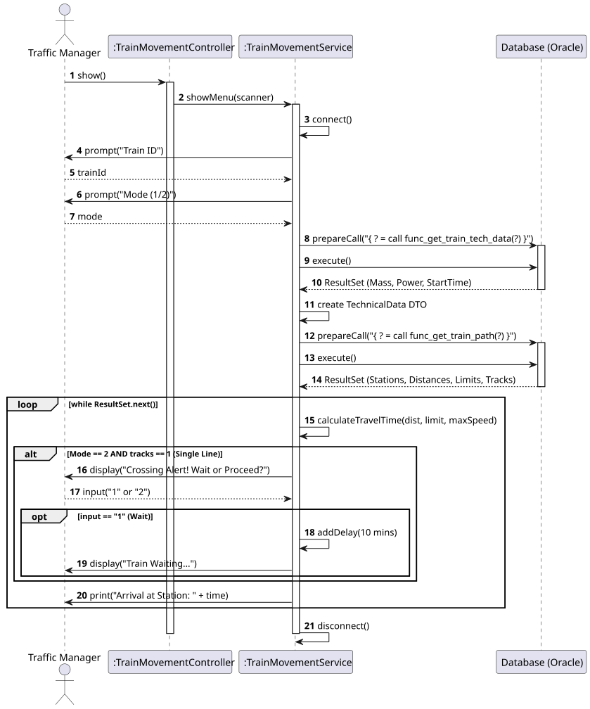
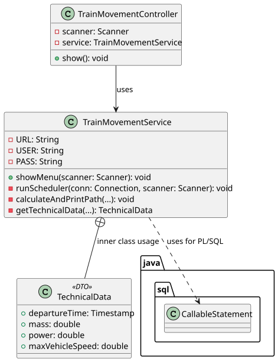

# USLP10 - Train Dispatch - Scheduling

## 3. Design

### 3.1. Rationale

**The rationale grounds on the SSD interactions and the requirement for PL/SQL integration.**

| Interaction ID | Question: Which class is responsible for... | Answer | Justification (with patterns) |
|:------------- |:--------------------- |:------------|:---------------------------- |
| Step 1 | ...handling user input (ID, Mode)? | TrainMovementController | **Controller**: Orchestrates the interaction layer. |
| Step 2 | ...encapsulating the logic and DB access? | TrainMovementService | **Pure Fabrication**: Centralizes the complex scheduling logic to keep the Controller clean. |
| Step 3 | ...executing the PL/SQL functions? | TrainMovementService | **Information Expert**: Holds the JDBC Connection and knows how to use `CallableStatement`. |
| Step 4 | ...holding the temporary calculation data? | TechnicalData (Inner Class) | **DTO**: A lightweight structure to pass Mass/Power/Time between methods without exposing them globally. |
| Step 5 | ...calculating the travel time ($T=D/V$)? | TrainMovementService | **Pure Fabrication**: The calculation logic is embedded in the service loop for this MVP. |

### Systematization

According to the taken rationale, the conceptual classes promoted to software classes are:

* **TrainMovementController** (UI Controller)
* **TrainMovementService** (Business Logic & Data Access)
* **TechnicalData** (DTO for calculation context)

---

## 3.2. Sequence Diagram (SD)

## 3.3. Class Diagram (CD)

