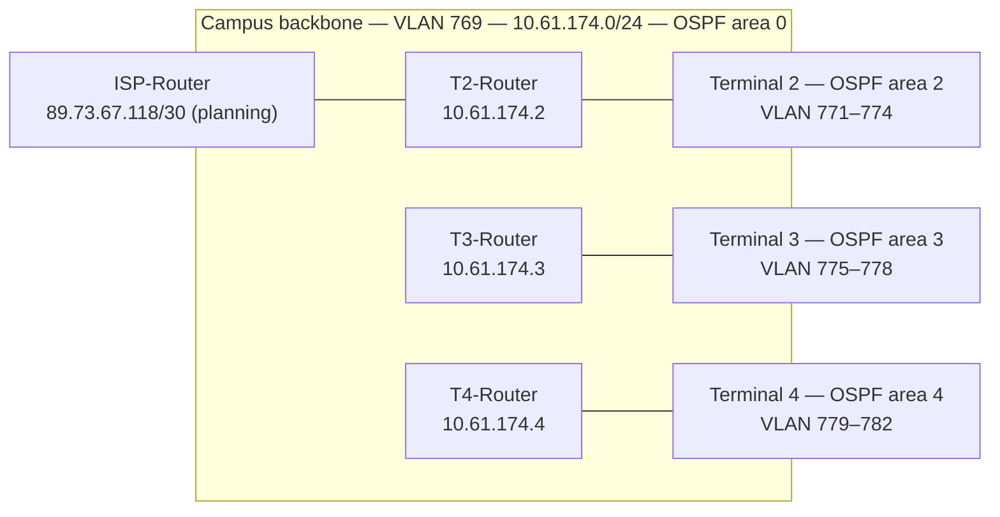

# Documentation index — RCOMP 2025/26 airport campus network

> Documentation added in 2026 (portfolio). This is a **map** of the team's original documents in [`../doc/`](../doc/); none of them was edited. Facts below were read from those files; anything not verifiable is marked `TODO: confirmar com o BMS`. Portuguese version: [INDEX.pt.md](INDEX.pt.md). See also [GLOSSARY](GLOSSARY.md) and [SETUP](SETUP.md).

## 1. Team and sprints

Members are identified in the original documents by student number only (names are not recorded, except 1221514 = Bruno Silva).

| Sprint | Dates | Sprint master | Theme | Members with deliverables |
|---|---|---|---|---|
| 1 | 2026-02-23 → 03-15 | 1221514 | Structured cabling design | 1221514 (T2 + campus backbone + global inventory), 1240904 (T3), 1240935 (T4), 1241165 (T5) |
| 2 | 2026-03-16 → 04-19 | 1240904 | Layer 2/3 Packet Tracer simulation | 1221514 (T2 + ISP), 1240904 (T3 + `campus.pkt`), 1240935 (T4) |
| 3 | 2026-04-19 → 05-17 | 1240935 | OSPF, DHCPv4, VoIP, DNS, NAT, ACLs | 1221514, 1240904, 1240935 |

Terminal 5 appears only in Sprint 1; Sprints 2–3 state "Terminal 5 — not applicable (the team covers Terminals 2, 3 and 4)" ([sprint 2 planning](../doc/sprint2/planning.md)).

## 2. Design at a glance

Verified against the Sprint 2 and Sprint 3 plannings.

| Topic | Decision (source) |
|---|---|
| Address block | `10.61.128.0/17`, 14 non-overlapping subnets ([sprint 2 planning §2.5](../doc/sprint2/planning.md)) |
| VLANs | VTP domain `rc2526deg2`, IDs 769–782: 2 shared (backbone, switches DMZ) + 4 per terminal (outlets, Wi-Fi, VoIP, servers) |
| Layer 2 | All inter-switch links are trunks; redundancy as rings between HCs of the same level; STP never disabled |
| Routing | Static in Sprint 2, replaced by OSPF in Sprint 3; T2 originates the default route |
| Services (Sprint 3) | DHCPv4 per router, VoIP (Cisco telephony service, dial-peers), DNS (root `rcomp-25-26-de-g2` at T2, delegated `terminal-3`/`terminal-4`), static NAT 80/443, ACL firewall implemented last |
| Cabling (Sprint 1) | T568B, CAT7 S/FTP horizontal, OM4 fibre backbones with redundant paths, MC at Terminal 2, cabinets sized with +100 % headroom ([sprint 1 planning §2](../doc/sprint1/planning.md)) |

## 3. Traceability: task → decision → deliverable → review

"Review" is the team's own verdict in `review.md`.

| Task | Owner | Decisions | Deliverables | Review |
|---|---|---|---|---|
| T.1.1 T2 + campus backbone | 1221514 | [planning](../doc/sprint1/planning.md) | [readme](../doc/sprint1/1221514/readme.md), [nivel1](../doc/sprint1/1221514/nivel1.md), [nivel4](../doc/sprint1/1221514/nivel4.md), [airportplan](../doc/sprint1/1221514/airportplan.md), [global inventory](../doc/sprint1/global-inventory.md), [img/](../doc/sprint1/1221514/img/) | Totally implemented, no issues |
| T.1.2 T3 | 1240904 | same | [README](../doc/sprint1/1240904/README.md), [img/](../doc/sprint1/1240904/img/) | Totally implemented, with 2 issues (OM4 backbone table; IC patch-panel justification) |
| T.1.3 T5 | 1241165 | same | [README](../doc/sprint1/1241165/README.md), [img/](../doc/sprint1/1241165/img/) | **Partially implemented**, with issues |
| T.1.4 T4 | 1240935 | same | [README](../doc/sprint1/1240935/README.md), [medidas.txt](../doc/sprint1/1240935/medidas.txt), [images/](../doc/sprint1/1240935/images/) | Totally implemented, no issues |
| T.2.1 T2 + ISP | 1221514 | [planning](../doc/sprint2/planning.md) | [README](../doc/sprint2/1221514/README.md), [Terminal2.pkt](../doc/sprint2/1221514/Terminal2.pkt), [configs](../doc/sprint2/1221514/docs-running-config/) | Totally implemented, no issues |
| T.2.2 T3 + `campus.pkt` | 1240904 | same | [README](../doc/sprint2/1240904/README.md), [campus.pkt](../doc/sprint2/1240904/campus.pkt), [Terminal3.pkt](../doc/sprint2/1240904/Terminal3.pkt) | Totally implemented, no issues |
| T.2.4 T4 | 1240935 | same | [README](../doc/sprint2/1240935/README.md), [Terminal4.pkt](../doc/sprint2/1240935/Terminal4.pkt), [configs](../doc/sprint2/1240935/docs/) | Totally implemented, no issues |
| T.3.1 T2 | 1221514 | [planning](../doc/sprint3/planning.md) | [README](../doc/sprint3/1221514/README.md), [Terminal2.pkt](../doc/sprint3/1221514/Terminal2.pkt), [configs + DNS records](../doc/sprint3/1221514/docs-running-config/) | Totally implemented, no issues |
| T.3.2 T3 + `campus.pkt` | 1240904 | same | [README](../doc/sprint3/1240904/README.md), [campus.pkt](../doc/sprint3/1240904/campus.pkt), [DNS records](../doc/sprint3/1240904/T3-DNS-records.png) | Totally implemented, no issues |
| T.3.4 T4 | 1240935 | same | [README](../doc/sprint3/1240935/README.md), [Terminal4.pkt](../doc/sprint3/1240935/Terminal4.pkt), [configs + DNS records](../doc/sprint3/1240935/docs-running-config/) | Totally implemented, no issues |

Whether the Sprint 1 issues of T3 and T5 were closed in later sprints is not recorded in the reviews. TODO: confirmar com o BMS.

## 4. Verified findings

| # | Finding | Where |
|---|---|---|
| 1 | The root README says "group of 3", but Sprint 1 has four member folders (1221514, 1240904, 1240935, 1241165) and a Terminal 5 design that was never completed | [README](../README.md), [sprint 1 review](../doc/sprint1/review.md) |
| 2 | The global inventory is partial: every T5 column is "(a calcular pelo T5)", so the "TOTAL GERAL" values are lower bounds (marked `~`) | [global-inventory.md](../doc/sprint1/global-inventory.md) |
| 3 | The Sprint 3 planning gives the T2 DNS server `10.61.173.129`, which is also the gateway of the T2 servers subnet; the T2 README implements `.130` for DNS, `.131` for HTTP and `.129` as gateway. Treat the README as the implemented state | [planning §2.5](../doc/sprint3/planning.md), [T2 README](../doc/sprint3/1221514/README.md) |
| 4 | `sprint2/4444444/` holds only the course template's placeholder README ("just an example for a team member with number 4444444") | [README](../doc/sprint2/4444444/README.md) |
| 5 | The Sprint 3 planning asks for `T4-Router.txt`-style config dumps; the delivered files are named `<device>_running-config.txt` | [planning §4](../doc/sprint3/planning.md) |
| 6 | `sprint3/1221514/README.md` contains mojibake (`→` for `→`, 11 lines) | [T2 README](../doc/sprint3/1221514/README.md) |
| 7 | 32 running-config files contain `enable secret 5` hashes or `password` lines; `ISP-Router_running-config.txt` has `password 7` (reversible encoding). Packet Tracer lab devices; values not reproduced here | [configs](../doc/sprint3/1221514/docs-running-config/) |

## 5. Improvement list (not applied)

| Priority | Improvement | Effort |
|---|---|---|
| P1 | Fix the `.129`/`.130` mismatch in the planning, or add a one-line erratum | 10 min |
| P1 | Fix the mojibake in the T2 Sprint 3 README (re-save the file as UTF-8 and restore the arrows) | 10 min |
| P2 | Record whether the Sprint 1 T3/T5 issues were closed | 30 min |
| P2 | Add `.gitattributes` for text EOL and mark `.pkt` as binary | 5 min |
| P3 | Export a PNG of the final `campus.pkt` topology for the README | 30 min |
| P3 | Remove the placeholder `sprint2/4444444/` folder | 2 min |
