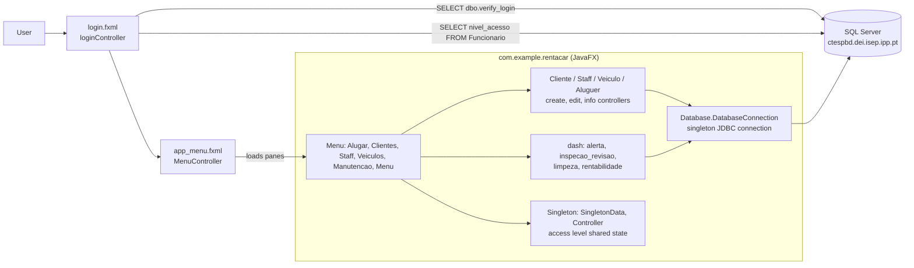
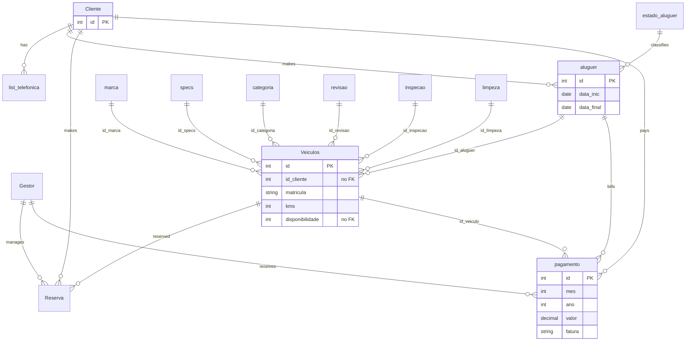

# Architecture — RentACar

> Documentation added in 2026 (portfolio). Derived from the source code; nothing here was written by the original team. Portuguese version: [ARCHITECTURE.pt.md](ARCHITECTURE.pt.md).

## Overview

JavaFX desktop application (Java 19, Gradle, JPMS module `com.example.rentacar`) that talks directly to a SQL Server database over JDBC. There is no service or repository layer: FXML controllers build SQL strings and run them on one shared connection. Business logic that is not in the controllers lives in the database (stored procedures, a login function and views).

## Packages

| Package (`com.example.rentacar.*`) | Role | Examples |
|---|---|---|
| (root) | JavaFX entry point; loads `login.fxml` | `Rent_a_carApplication` |
| `Menu` | Login, main window, side navigation, one controller per pane | `loginController`, `LoginService`, `MenuController`, `app_pane_*Controller` |
| `Cliente` | Client list/detail/create/edit | `Criar_ClienteController`, `infoClienteController`, `Clientes` |
| `Staff` | Staff list/detail/create/edit | `Criar_StaffController`, `Edit_StaffController`, `funcionario` |
| `Veiculo` | Vehicle list/detail/create/edit | `Criar_VeiculoController`, `infoVeiculoController`, `Veiculo` |
| `Aluguer` | Rentals, quotes (`Orcamento`), invoices, receipts, payments | `Criar_AluguerController`, `OrcamentoController`, `fatura`, `recibo`, `pagamento` |
| `dash` | Dashboards: alerts, inspection/service, cleaning, profitability | `dash_alertaController`, `dash_limpezaController`, `dash_rentabilidadeController` |
| `Database` | Singleton JDBC connection | `DatabaseConnection` |
| `Singleton` | Shared session state (logged-in id, access level) | `SingletonData`, `Controller` |

Resources: 31 FXML views in `src/main/resources/com/example/rentacar/` (one per screen or dialog) and `images/`.

## Main flows

### Login and access levels

1. `loginController` / `LoginService.verifyLogin` runs `SELECT dbo.verify_login('<user>','<pass>')`; a result greater than 0 is a valid login.
2. `buscarnv_acesso` reads `nivel_acesso` from `Funcionario` by `nome`.
3. `MenuController.initialize` stores the level in `SingletonData` and hides navigation:

| `nivel_acesso` | Hidden in the UI |
|---|---|
| 1 | Staff and Veiculos buttons |
| 2 | Staff button |
| 3 or more | Nothing hidden |

`app_pane_menuController` additionally hides the `paneRent` panel for levels below 3. Access control is therefore UI-only (see Known issues).

### Creating a rental

`Criar_AluguerController` fills combo boxes from the `ListarVeiculo` view and the lookup tables, then calls the stored procedures `dbo.Alugar_carro` and `Alugar_carros2`. Editing goes through `Atualizar_aluguer` (and `Alugar_carros2` again). Quotes, invoices and receipts are produced by the `Aluguer` package (`Orcamento`, `fatura`, `recibo`).

## Data model

Two sources disagree, so both are shown.

**A. What `src/main/java/olabomdia.sql` creates** (schema only: no `INSERT`, no procedures, functions or views):

Script observations: `Veiculos.id_aluguer` is `NOT NULL`, so a vehicle row needs a rental row; `Veiculos.id_cliente` and `Veiculos.disponibilidade` have no foreign key; `Veiculo_disponibilidade`, `estado_pagamento` and `tipo_pagamento` exist as lookup tables but `pagamento.estado` / `pagamento.tipo_pagamento` and `Veiculos.disponibilidade` do not reference them.

**B. What the Java code queries but the script does not create** (the live database is the real source of truth):

| Kind | Names found in the code |
|---|---|
| Tables | `Funcionario`, `Contratos`/`contratos`, `manutencao`, `seguro`, `modelo`, `marca_modelo`, `tipo_combustivel`, `list_telefonica_cliente` |
| Views | `ListarVeiculo`, `ConsultarAluguer` |
| Stored procedures | `InserirCliente`, `InserirStaff`, `Alugar_carro`, `Alugar_carros2`, `Atualizar_aluguer`, `Topo_marcas`, `registo_aluguer_cliente` |
| Functions | `dbo.verify_login` |

Conversely, `Gestor` and `Reserva` appear in the script but are not queried by the controllers (the `Reserva` class under `dash` is a model class). Conclusion: the committed script is an early version of the schema; the application targets a later one that is not in the repository. TODO: confirmar com o BMS (export the final schema from the course database to complete this document).

## Dependencies

From `RentACar/build.gradle`: JavaFX 19.0.2 (`controls`, `fxml`, `web`, `media`), ControlsFX 11.1.2, FormsFX 11.6.0, ValidatorFX 0.4.0, Ikonli 12.3.1, BootstrapFX 0.4.0, `mssql-jdbc` 9.4.0.jre11, JUnit 5.9.2 (declared, no tests in the repository), plugins `moduleplugin`, `javafxplugin`, `jlink`.

## Known issues (verified in the code, not fixed)

| # | Issue | Evidence |
|---|---|---|
| 1 | `application.mainClass` is `com.example.rentacar.HelloApplication`, which does not exist; the entry point is `Rent_a_carApplication`. `./gradlew run` is expected to fail until corrected. | `build.gradle`, `Rent_a_carApplication.java` |
| 2 | SQL injection: login, access-level lookup and the `EXEC` calls concatenate user input into SQL strings. | `LoginService.java`, `loginController.java`, `Criar_ClienteController.java` |
| 3 | Authorization is enforced only by hiding buttons. | `MenuController.java` |
| 4 | Database host, name and user are hardcoded (only the password is configurable). | `DatabaseConnection.java` |
| 5 | A failed connection is printed and swallowed; the `Connection` stays `null` and later calls throw. | `DatabaseConnection.java` |
| 6 | The committed SQL script does not contain the objects the code needs (section B). | `olabomdia.sql` |
| 7 | No automated tests, no CI. | `src/` has only `main` |
