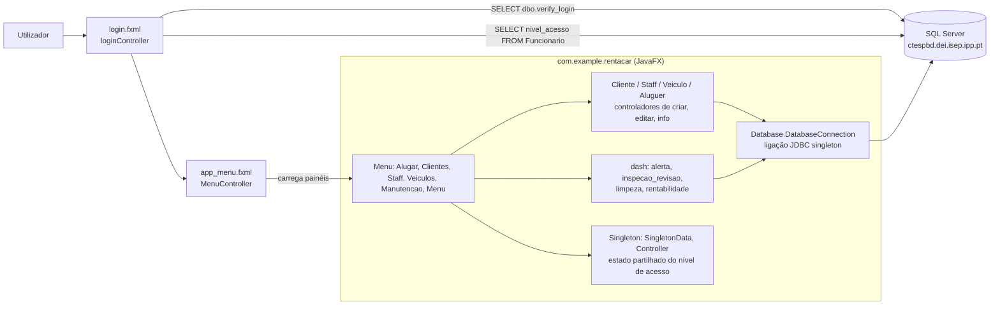
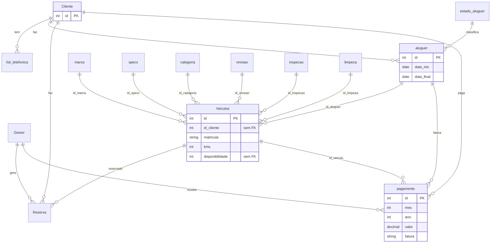

# Arquitetura — RentACar

> Documentação adicionada em 2026 (portfolio). Derivada do código-fonte; nada aqui foi escrito pela equipa original. English version: [ARCHITECTURE.md](ARCHITECTURE.md).

## Visão geral

Aplicação desktop JavaFX (Java 19, Gradle, módulo JPMS `com.example.rentacar`) que fala diretamente com uma base de dados SQL Server por JDBC. Não há camada de serviços nem de repositórios: os controladores FXML constroem strings SQL e executam-nas numa ligação partilhada. A lógica de negócio que não está nos controladores vive na base de dados (procedimentos armazenados, uma função de login e vistas).

## Pacotes

| Pacote (`com.example.rentacar.*`) | Papel | Exemplos |
|---|---|---|
| (raiz) | Ponto de entrada JavaFX; carrega `login.fxml` | `Rent_a_carApplication` |
| `Menu` | Login, janela principal, navegação lateral, um controlador por painel | `loginController`, `LoginService`, `MenuController`, `app_pane_*Controller` |
| `Cliente` | Lista/detalhe/criação/edição de clientes | `Criar_ClienteController`, `infoClienteController`, `Clientes` |
| `Staff` | Lista/detalhe/criação/edição de staff | `Criar_StaffController`, `Edit_StaffController`, `funcionario` |
| `Veiculo` | Lista/detalhe/criação/edição de veículos | `Criar_VeiculoController`, `infoVeiculoController`, `Veiculo` |
| `Aluguer` | Alugueres, orçamentos (`Orcamento`), faturas, recibos, pagamentos | `Criar_AluguerController`, `OrcamentoController`, `fatura`, `recibo`, `pagamento` |
| `dash` | Dashboards: alertas, inspeção/revisão, limpeza, rentabilidade | `dash_alertaController`, `dash_limpezaController`, `dash_rentabilidadeController` |
| `Database` | Ligação JDBC singleton | `DatabaseConnection` |
| `Singleton` | Estado de sessão partilhado (id do utilizador, nível de acesso) | `SingletonData`, `Controller` |

Recursos: 31 vistas FXML em `src/main/resources/com/example/rentacar/` (uma por ecrã ou diálogo) e `images/`.

## Fluxos principais

### Login e níveis de acesso

1. `loginController` / `LoginService.verifyLogin` executa `SELECT dbo.verify_login('<user>','<pass>')`; um resultado maior que 0 é um login válido.
2. `buscarnv_acesso` lê `nivel_acesso` de `Funcionario` pelo `nome`.
3. `MenuController.initialize` guarda o nível em `SingletonData` e esconde a navegação:

| `nivel_acesso` | Escondido na interface |
|---|---|
| 1 | Botões Staff e Veiculos |
| 2 | Botão Staff |
| 3 ou mais | Nada escondido |

`app_pane_menuController` esconde ainda o painel `paneRent` para níveis abaixo de 3. O controlo de acessos é, portanto, só ao nível da interface (ver Problemas conhecidos).

### Criar um aluguer

`Criar_AluguerController` preenche as combo boxes a partir da vista `ListarVeiculo` e das tabelas de apoio, e depois chama os procedimentos `dbo.Alugar_carro` e `Alugar_carros2`. A edição passa por `Atualizar_aluguer` (e `Alugar_carros2` outra vez). Orçamentos, faturas e recibos são produzidos pelo pacote `Aluguer` (`Orcamento`, `fatura`, `recibo`).

## Modelo de dados

Duas fontes discordam, por isso mostram-se as duas.

**A. O que `src/main/java/olabomdia.sql` cria** (só esquema: sem `INSERT`, sem procedimentos, funções ou vistas):

Observações ao script: `Veiculos.id_aluguer` é `NOT NULL`, logo um veículo exige uma linha de aluguer; `Veiculos.id_cliente` e `Veiculos.disponibilidade` não têm chave estrangeira; `Veiculo_disponibilidade`, `estado_pagamento` e `tipo_pagamento` existem como tabelas de apoio mas `pagamento.estado`, `pagamento.tipo_pagamento` e `Veiculos.disponibilidade` não as referenciam.

**B. O que o código Java consulta mas o script não cria** (a base de dados real é a fonte de verdade):

| Tipo | Nomes encontrados no código |
|---|---|
| Tabelas | `Funcionario`, `Contratos`/`contratos`, `manutencao`, `seguro`, `modelo`, `marca_modelo`, `tipo_combustivel`, `list_telefonica_cliente` |
| Vistas | `ListarVeiculo`, `ConsultarAluguer` |
| Procedimentos | `InserirCliente`, `InserirStaff`, `Alugar_carro`, `Alugar_carros2`, `Atualizar_aluguer`, `Topo_marcas`, `registo_aluguer_cliente` |
| Funções | `dbo.verify_login` |

Inversamente, `Gestor` e `Reserva` aparecem no script mas não são consultadas pelos controladores (a classe `Reserva` em `dash` é uma classe de modelo). Conclusão: o script versionado é uma versão inicial do esquema; a aplicação aponta a uma versão posterior que não está no repositório. TODO: confirmar com o BMS (exportar o esquema final da base de dados da cadeira para completar este documento).

## Dependências

De `RentACar/build.gradle`: JavaFX 19.0.2 (`controls`, `fxml`, `web`, `media`), ControlsFX 11.1.2, FormsFX 11.6.0, ValidatorFX 0.4.0, Ikonli 12.3.1, BootstrapFX 0.4.0, `mssql-jdbc` 9.4.0.jre11, JUnit 5.9.2 (declarado, sem testes no repositório), plugins `moduleplugin`, `javafxplugin`, `jlink`.

## Problemas conhecidos (verificados no código, não corrigidos)

| # | Problema | Evidência |
|---|---|---|
| 1 | `application.mainClass` é `com.example.rentacar.HelloApplication`, que não existe; o ponto de entrada é `Rent_a_carApplication`. `./gradlew run` deve falhar até ser corrigido. | `build.gradle`, `Rent_a_carApplication.java` |
| 2 | Injeção de SQL: o login, a consulta do nível de acesso e as chamadas `EXEC` concatenam input do utilizador em strings SQL. | `LoginService.java`, `loginController.java`, `Criar_ClienteController.java` |
| 3 | A autorização é aplicada só escondendo botões. | `MenuController.java` |
| 4 | Servidor, nome da base de dados e utilizador estão fixos no código (só a password é configurável). | `DatabaseConnection.java` |
| 5 | Uma ligação falhada é impressa e ignorada; a `Connection` fica `null` e as chamadas seguintes lançam exceção. | `DatabaseConnection.java` |
| 6 | O script SQL versionado não contém os objetos de que o código precisa (secção B). | `olabomdia.sql` |
| 7 | Sem testes automáticos nem CI. | `src/` só tem `main` |
