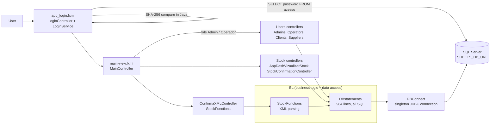
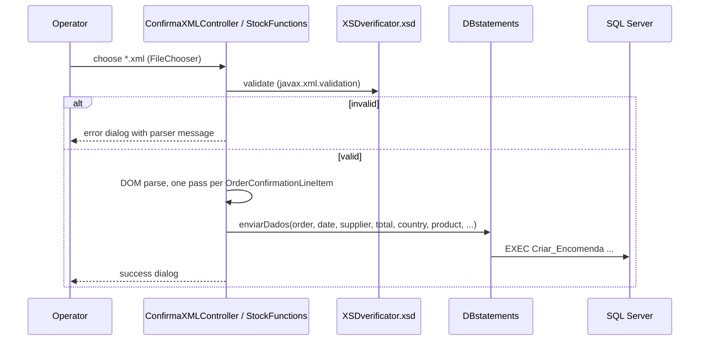
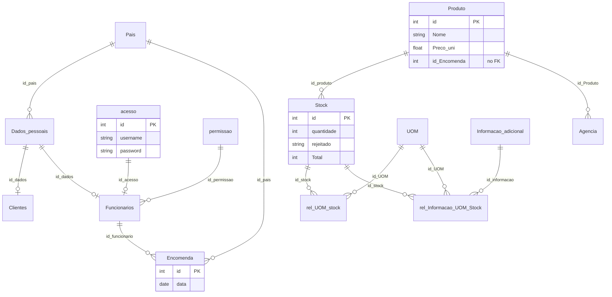

# Architecture — Sheets and Picks (LP3)

> Documentation added in 2026 (portfolio). Derived from the source code and the SQL export; nothing here was written by the original team. Portuguese version: [ARCHITECTURE.pt.md](ARCHITECTURE.pt.md). The team's own diagrams (use cases, sequence, domain, class, database) are in this same folder.

## Overview

JavaFX desktop application (Java 17, Gradle, JPMS module `com.example.sheetsandpicks`) for stock and order management. Users sign in with a role (Admin, Operador, Fornecedor); the main window shows different menus per role. Supplier order confirmations arrive as XML, are validated against an XSD and stored through a stored procedure; operators then confirm or reject the received stock. Persistence is plain JDBC to SQL Server.

## Packages (`com.example.sheetsandpicks.*`)

| Package | Role | Key files |
|---|---|---|
| (root) | Entry point `MainApplication` (loads `app_login.fxml`, 1280x720), XML validation screen | `MainApplication`, `ConfirmaXMLController` |
| `Controllers` | Main window and role-based navigation | `MainController` |
| `Controllers.app_login` | Login screen and authentication | `loginController`, `LoginService` |
| `Controllers.app_dashboard` | User administration screens | `app_dash_utilizadoresController`, `app_dash_updateutilizadoresController` |
| `Controllers.Users` | One controller per role list | `AdminsController`, `OperatorsController`, `ClientsController`, `SuppliersController` |
| `Controllers.Stock` | Stock list and confirmation pop-up | `AppDashVizualizarStock`, `StockConfirmationController`, `PopUp_ConfirmarStockController` |
| `Controllers.database` | Singleton JDBC connection | `DBConnect` |
| `BL` | All SQL (`BL/Database/DBstatements`), XML import (`BL/Stock/StockFunctions`), window helper (`BL/util`) | |
| `Models` | Table row models for the JavaFX tables | `Stock`, `Encomenda`, `Admins`, `Operators`, `Clients`, `Suppliers`, `Pais` |

Resources: 14 FXML views and `css/mainstyle.css` in `src/main/resources`.

## Roles and menus

`MainController.atualizarComboUti` fills the user menu from `permissao.Tipo`:

| Role | User menu | Stock menu |
|---|---|---|
| Admin | Clientes, Fornecedor, Operador, Admin | Ver Stock |
| Operador | Clientes, Fornecedor | Ver Stock |
| Fornecedor | Perfil | Ver Stock (supplier view) |

## Main flows

### Login

1. `LoginService.verifyLogin` selects `acesso.password` by `username`, hashes the typed password with SHA-256 (hex, no salt) and compares the strings in Java.
2. `LoginService.getNivelAcesso` joins `acesso` → `Funcionarios` → `permissao` to get the role name.
3. `loginController` opens `main-view.fxml` and passes the role to `MainController`.

### XML order import

Two entry points reach this flow: the `app(DEMO)XMLUpload.fxml` screen (`ConfirmaXMLController`) and the stock view (`AppDashVizualizarStock` → `StockFunctions.Verificarxml`).

The line total is `quantity × unit price × 1.23` (23% VAT hardcoded in `StockFunctions`). The XSD models an `OrderConfirmation` (header with reference, issue date and supplier address; line items with part numbers per agency, price, quantity, net weight and counts with units of measure). Sample inputs: `XMLs/XML-Sample-4.2.xml` … `4.6.xml`.

### Stock confirmation

`Listar_Stock_Confirmar` feeds the confirmation screen; `DBstatements.ConfirmarStock` runs `EXEC ConfirmacaodeStock @id = ?` or `EXEC RejeitarStock @id = ?`.

## Data model

Source: `Docs/drawSQL-sqlsrv-export-2023-12-02.sql` (a drawSQL export: 14 tables, 14 foreign keys, no data, no procedures or views). The team's own picture is `Modelo de base de dados.png`.

Observations:

- Suppliers, operators and admins are all `Funcionarios` rows distinguished by `permissao`; `Clientes` is a separate table. Both point to `Dados_pessoais` (name, address, country, e-mail, birth date).
- `Produto.id_Encomenda` has **no foreign key**, so an order is linked to its products only by convention.
- Every `VARCHAR NOT NULL` in the export has no length; in SQL Server a bare `VARCHAR` column is `VARCHAR(1)`. The real database must have been created differently. TODO: confirmar com o BMS.
- Code also uses objects that are not in the export: views `Listar_Stock`, `Listar_Stock_Confirmar`, `Ver_pais`; procedures `Criar_Funcionario`, `Alterar_Funcionario`, `Eliminar_Funcionario`, `Criar_Cliente`, `Alterar_Cliente`, `Eliminar_Cliente`, `Criar_Encomenda`, `ConfirmacaodeStock`, `RejeitarStock`.

## Dependencies

From `gp2-lp3/SheetsAndPicks/build.gradle`: JavaFX plugin 0.0.13 with JavaFX `19` (`controls`, `fxml`) plus an explicit `javafx-controls:15`, ControlsFX 11.1.2, FormsFX 11.6.0, `mssql-jdbc` 9.4.0.jre8, JUnit 4.13.1, plugins `moduleplugin` and `jlink`. Gradle wrapper 8.4.

## Known issues (verified in the code, not fixed)

| # | Issue | Evidence |
|---|---|---|
| 1 | XSD paths are hardcoded: `C:\Trabalho\Fichalp3\gp2-lp3\XSDverificator.xsd` (one screen) and `SheetsAndPicks/src/main/XSDverificator.xsd` relative to the working directory (the other). Validation only works on the original machine or from a specific directory. | `ConfirmaXMLController.java`, `StockFunctions.java` |
| 2 | `ConfirmarStock` sets the parameter in a loop but executes once after it, so only the last id is processed; it also compares strings with `!=`. | `DBstatements.java` |
| 3 | SQL injection in login and role lookup (`username` concatenated). Passwords are unsalted SHA-256. | `LoginService.java` |
| 4 | `MainController` falls back to `app_utilizador_movimentos.fxml`, which does not exist (only `app_fornecedor_movimentos.fxml`). | `MainController.java`, `src/main/resources` |
| 5 | The only test is an empty class (`Verifylogintest`); JUnit 4 is declared and `useJUnitPlatform()` is commented out. | `src/test`, `build.gradle` |
| 6 | The `SHEETS_DB_URL` variable carries credentials inside the JDBC URL; a missing variable throws `IllegalStateException`, which `DBConnect` does not catch. | `DBConnect.java` |
| 7 | Repository hygiene: `.gradle/` caches, `bin/` build output, a `.lnk` shortcut, a duplicate `drive-download-…/` copy of `XMLs/` and a stray `com/gluonhq/.../TextField.java` inside `resources` are committed. | `sheets-and-picks/` tree |
