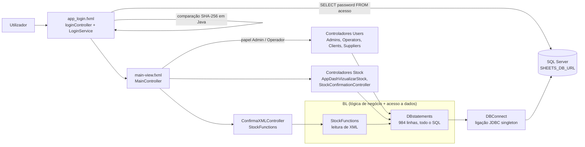
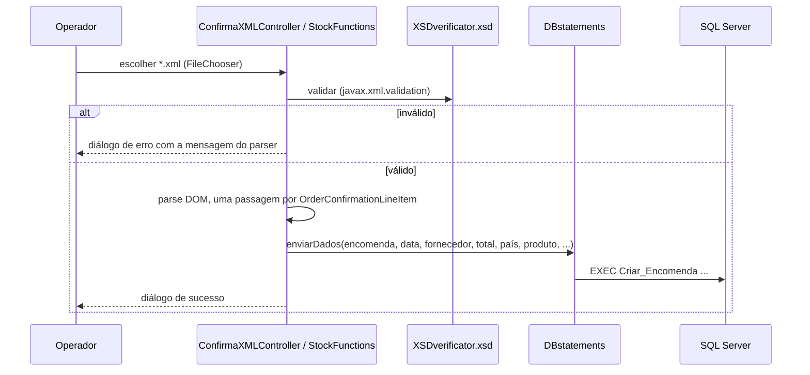
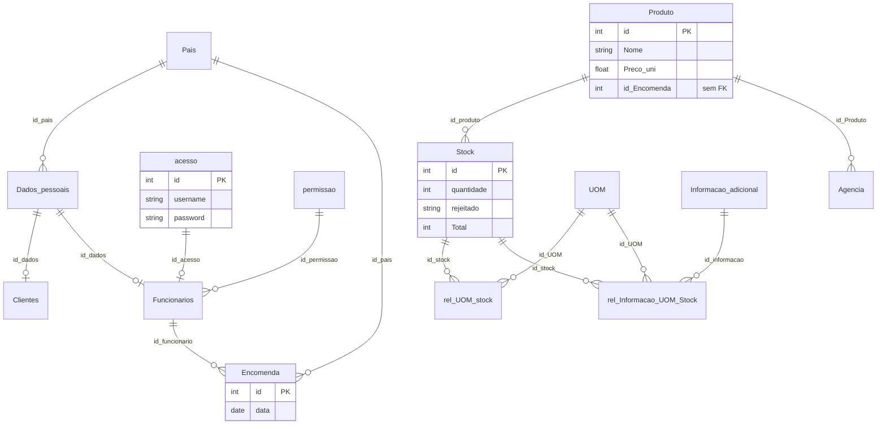

# Arquitetura — Sheets and Picks (LP3)

> Documentação adicionada em 2026 (portfolio). Derivada do código-fonte e do export SQL; nada aqui foi escrito pela equipa original. English version: [ARCHITECTURE.md](ARCHITECTURE.md). Os diagramas da própria equipa (casos de uso, sequência, domínio, classes, base de dados) estão nesta mesma pasta.

## Visão geral

Aplicação desktop JavaFX (Java 17, Gradle, módulo JPMS `com.example.sheetsandpicks`) para gestão de stock e encomendas. Os utilizadores entram com um papel (Admin, Operador, Fornecedor) e a janela principal mostra menus diferentes por papel. As confirmações de encomenda dos fornecedores chegam em XML, são validadas contra um XSD e guardadas através de um procedimento armazenado; depois os operadores confirmam ou rejeitam o stock recebido. A persistência é JDBC simples para SQL Server.

## Pacotes (`com.example.sheetsandpicks.*`)

| Pacote | Papel | Ficheiros principais |
|---|---|---|
| (raiz) | Ponto de entrada `MainApplication` (carrega `app_login.fxml`, 1280x720), ecrã de validação de XML | `MainApplication`, `ConfirmaXMLController` |
| `Controllers` | Janela principal e navegação por papel | `MainController` |
| `Controllers.app_login` | Ecrã de login e autenticação | `loginController`, `LoginService` |
| `Controllers.app_dashboard` | Ecrãs de administração de utilizadores | `app_dash_utilizadoresController`, `app_dash_updateutilizadoresController` |
| `Controllers.Users` | Um controlador por lista de papel | `AdminsController`, `OperatorsController`, `ClientsController`, `SuppliersController` |
| `Controllers.Stock` | Lista de stock e pop-up de confirmação | `AppDashVizualizarStock`, `StockConfirmationController`, `PopUp_ConfirmarStockController` |
| `Controllers.database` | Ligação JDBC singleton | `DBConnect` |
| `BL` | Todo o SQL (`BL/Database/DBstatements`), importação de XML (`BL/Stock/StockFunctions`), auxiliar de janelas (`BL/util`) | |
| `Models` | Modelos de linha para as tabelas JavaFX | `Stock`, `Encomenda`, `Admins`, `Operators`, `Clients`, `Suppliers`, `Pais` |

Recursos: 14 vistas FXML e `css/mainstyle.css` em `src/main/resources`.

## Papéis e menus

`MainController.atualizarComboUti` preenche o menu de utilizadores a partir de `permissao.Tipo`:

| Papel | Menu de utilizadores | Menu de stock |
|---|---|---|
| Admin | Clientes, Fornecedor, Operador, Admin | Ver Stock |
| Operador | Clientes, Fornecedor | Ver Stock |
| Fornecedor | Perfil | Ver Stock (vista de fornecedor) |

## Fluxos principais

### Login

1. `LoginService.verifyLogin` seleciona `acesso.password` pelo `username`, calcula o SHA-256 (hex, sem salt) da password escrita e compara as strings em Java.
2. `LoginService.getNivelAcesso` junta `acesso` → `Funcionarios` → `permissao` para obter o nome do papel.
3. `loginController` abre `main-view.fxml` e passa o papel ao `MainController`.

### Importação de encomendas em XML

Há dois pontos de entrada para este fluxo: o ecrã `app(DEMO)XMLUpload.fxml` (`ConfirmaXMLController`) e a vista de stock (`AppDashVizualizarStock` → `StockFunctions.Verificarxml`).

O total de cada linha é `quantidade × preço unitário × 1.23` (IVA de 23% fixo em `StockFunctions`). O XSD modela uma `OrderConfirmation` (cabeçalho com referência, data de emissão e morada do fornecedor; linhas com part numbers por agência, preço, quantidade, peso líquido e contagens com unidades de medida). Exemplos de entrada: `XMLs/XML-Sample-4.2.xml` … `4.6.xml`.

### Confirmação de stock

A vista `Listar_Stock_Confirmar` alimenta o ecrã de confirmação; `DBstatements.ConfirmarStock` executa `EXEC ConfirmacaodeStock @id = ?` ou `EXEC RejeitarStock @id = ?`.

## Modelo de dados

Fonte: `Docs/drawSQL-sqlsrv-export-2023-12-02.sql` (export do drawSQL: 14 tabelas, 14 chaves estrangeiras, sem dados, sem procedimentos nem vistas). A imagem da própria equipa é `Modelo de base de dados.png`.

Observações:

- Fornecedores, operadores e admins são todos linhas de `Funcionarios` distinguidas por `permissao`; `Clientes` é uma tabela à parte. Ambas apontam para `Dados_pessoais` (nome, morada, país, e-mail, data de nascimento).
- `Produto.id_Encomenda` **não tem chave estrangeira**, logo a ligação entre encomenda e produtos é só por convenção.
- Todos os `VARCHAR NOT NULL` do export não têm comprimento; no SQL Server uma coluna `VARCHAR` sem tamanho é `VARCHAR(1)`. A base real deve ter sido criada de outra forma. TODO: confirmar com o BMS.
- O código usa também objetos que não estão no export: vistas `Listar_Stock`, `Listar_Stock_Confirmar`, `Ver_pais`; procedimentos `Criar_Funcionario`, `Alterar_Funcionario`, `Eliminar_Funcionario`, `Criar_Cliente`, `Alterar_Cliente`, `Eliminar_Cliente`, `Criar_Encomenda`, `ConfirmacaodeStock`, `RejeitarStock`.

## Dependências

De `gp2-lp3/SheetsAndPicks/build.gradle`: plugin JavaFX 0.0.13 com JavaFX `19` (`controls`, `fxml`) mais um `javafx-controls:15` explícito, ControlsFX 11.1.2, FormsFX 11.6.0, `mssql-jdbc` 9.4.0.jre8, JUnit 4.13.1, plugins `moduleplugin` e `jlink`. Gradle wrapper 8.4.

## Problemas conhecidos (verificados no código, não corrigidos)

| # | Problema | Evidência |
|---|---|---|
| 1 | Os caminhos do XSD estão fixos: `C:\Trabalho\Fichalp3\gp2-lp3\XSDverificator.xsd` (um ecrã) e `SheetsAndPicks/src/main/XSDverificator.xsd` relativo à pasta de trabalho (o outro). A validação só funciona na máquina original ou a partir de uma pasta específica. | `ConfirmaXMLController.java`, `StockFunctions.java` |
| 2 | `ConfirmarStock` define o parâmetro num ciclo mas executa uma só vez no fim, por isso só o último id é processado; compara ainda strings com `!=`. | `DBstatements.java` |
| 3 | Injeção de SQL no login e na consulta do papel (`username` concatenado). Passwords com SHA-256 sem salt. | `LoginService.java` |
| 4 | O `MainController` recorre a `app_utilizador_movimentos.fxml`, que não existe (só há `app_fornecedor_movimentos.fxml`). | `MainController.java`, `src/main/resources` |
| 5 | O único teste é uma classe vazia (`Verifylogintest`); o JUnit 4 está declarado e `useJUnitPlatform()` está comentado. | `src/test`, `build.gradle` |
| 6 | A variável `SHEETS_DB_URL` leva as credenciais dentro do URL JDBC; se faltar, lança `IllegalStateException`, que o `DBConnect` não apanha. | `DBConnect.java` |
| 7 | Higiene do repositório: caches `.gradle/`, `bin/`, um atalho `.lnk`, uma cópia `drive-download-…/` de `XMLs/` e um `com/gluonhq/.../TextField.java` perdido em `resources` estão versionados. | árvore de `sheets-and-picks/` |
